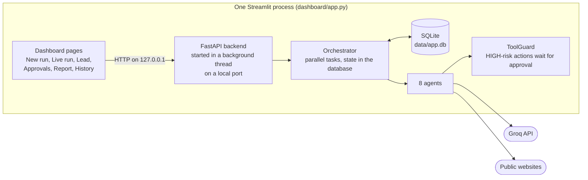

# AI Autonomous Business OS

Give it **one company website**. A team of AI agents researches the company, audits its website, scores it as a sales lead, proposes meeting times and drafts an outreach email. **Then the run stops and waits for you.** Nothing is sent until you approve it, and by default (`DRY_RUN=true`) even an approved email is only marked *sent (dry run)*.

It runs as **one Streamlit app**: the dashboard and the backend start together in a single process, so it deploys on **Streamlit Community Cloud alone** (no Render, no second server).

## How it works



Default plan: `research` + `website` (in parallel) -> `scoring` -> `scheduling` -> `communication` -> **human approval** -> `followup` -> `verification` -> `report`.

## Run it on your computer (one command)

Needs Python 3.11+ and a free [Groq API key](https://console.groq.com/keys).

```bash
python -m venv .venv
source .venv/bin/activate            # Windows PowerShell: .venv\Scripts\Activate.ps1
pip install -r requirements.txt

cp .env.example .env                 # Windows: copy .env.example .env
# open .env and set GROQ_API_KEY

streamlit run dashboard/app.py       # the backend starts by itself; open http://localhost:8501
```

In the app: **New run** -> paste a company website (or press **Load demo scenario**) -> **Start run** -> watch **Live run** -> decide on the email under **Approvals** -> read the **Report**. A green *Safe mode* badge in the sidebar shows `DRY_RUN=true`.

Edit `business_profile.yaml` first: it says who is sending the outreach (agency, sender, services, three meeting slots), and every email is written from it.

## Deploy on Streamlit Community Cloud

1. **Push this folder to a GitHub repository.** Check first that `.env` is NOT in it (it is git-ignored; `git status` should not list it). The repository root must contain `requirements.txt`, `dashboard/`, `app/` and `business_profile.yaml`.
2. Go to [share.streamlit.io](https://share.streamlit.io), sign in with GitHub and choose **Create app** -> **Deploy a public app from GitHub**.
3. Fill in the form:
   - **Repository / Branch:** yours, usually `main`
   - **Main file path:** `dashboard/app.py`
   - **Advanced settings -> Python version:** `3.12` or `3.13`
   - **Advanced settings -> Secrets:** paste the lines from [`.streamlit/secrets.toml.example`](.streamlit/secrets.toml.example) with your own `GROQ_API_KEY`:
     ```toml
     GROQ_API_KEY = "your_key_here"
     GROQ_MODEL = "openai/gpt-oss-120b"
     DRY_RUN = "true"
     ```
4. Click **Deploy**. The first start installs the requirements (a few minutes), then the app opens on `https://<your-app>.streamlit.app`.

You can change secrets later under **Manage app -> Settings -> Secrets**; the app restarts on save.

### Things to know about the hosted app

- **Keep `DRY_RUN = "true"` and do not add `SMTP_*` secrets.** The app is on the public internet; with these settings it cannot send a real email, whatever anyone clicks.
- **Your API key is spent by anyone who can open the app.** To limit that, use **Share -> Who can view this app** to allow only specific email addresses. Each run uses at most `MAX_LLM_CALLS_PER_RUN` (12) model calls.
- **The database is temporary.** SQLite lives on the app's disk, which Streamlit Cloud resets when the app restarts or redeploys, so old runs and leads disappear. Fine for a demo; for permanent history you would point `DATABASE_URL` at an external database.
- **Idle apps go to sleep** and wake with one click. The backend restarts with the app, and the first page load shows *Starting the AI Business OS backend...* for a moment.
- **Never commit secrets.** `.env`, `.streamlit/secrets.toml` and `data/*.db` are in `.gitignore`.

## Configuration

Locally these go in `.env`; on Streamlit Cloud they go in **Secrets**. Full list: [`.env.example`](.env.example).

| Variable | Default | Meaning |
|---|---|---|
| `GROQ_API_KEY` | none | Required to run the agents |
| `GROQ_MODEL` | `llama-3.3-70b-versatile` | Model name |
| `DRY_RUN` | `true` | `false` really sends approved emails (also needs `SMTP_*`) |
| `WEB_SEARCH_ENABLED` | `true` | DuckDuckGo search is optional and sometimes blocked |
| `MAX_LLM_CALLS_PER_RUN` | `12` | Hard cap on model calls per run, retries included |
| `TASK_TIMEOUT_S` | `90` | Per-task time limit |
| `EMBED_BACKEND` | `true` | `false` = do not start the backend inside Streamlit (you run `uvicorn app.main:app` yourself) |

## Safety

- Web page text is fenced as untrusted data in every prompt; tools, recipients and approvals are decided by code and by a person, never by page text.
- `send_email` and `create_event` only create a pending approval; they run after a human approves, and a message is never sent twice.
- Unknown tools are denied; the crawler blocks private and local addresses (SSRF guard) on every request and redirect.
- A per-run cap on model calls, a per-task timeout and bounded retries stop runaway loops.

## Tests

```bash
pytest -q
```

The suite uses a fake internet and a fake model, so it needs no key and no network. It turns the embedded backend off (`EMBED_BACKEND=false`) and drives the API in-process.

## Project layout

```
dashboard/            Streamlit app (app.py = entry point, embedded_backend.py, ui_kit.py, views/)
app/                  FastAPI backend: main.py, core/ (orchestrator, approvals, tool_guard, llm_gateway),
                      agents/, tools/, prompts/, schemas/, db/
business_profile.yaml who is sending the outreach (edit this)
tests/                pytest suite + fixtures/site (the fake internet)
scripts/              init_db.py, run_demo.py (optional helpers)
.streamlit/           config.toml, secrets.toml.example
```

## Known limits

- The calendar is a mock: slots come from `business_profile.yaml`; nothing is booked anywhere.
- Groq is the only LLM provider implemented.
- Lead scores are an LLM judgement, so they can vary a little between runs.
